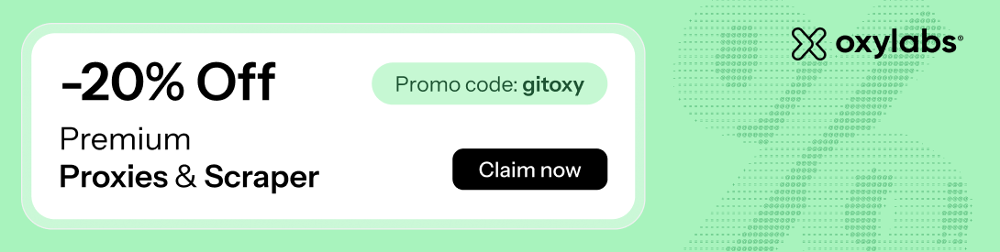

# Shein Scraper API

[](https://oxylabs.io/pages/gitoxy?utm_source=877&utm_medium=affiliate&groupid=877&utm_content=shein-scraper-github&transaction_id=102f49063ab94276ae8f116d224b67)

<p align="left">
  <a href="https://dashboard.oxylabs.io"></a>
  <a href="https://developers.oxylabs.io/products/web-api"></a>
  <a href="https://dashboard.oxylabs.io"></a>
  <a href="https://discord.gg/Pds3gBmKMH"></a>
  <a href="https://www.youtube.com/@oxylabs"></a>
</p>

Oxylabs [Shein Scraper](https://oxylabs.io/products/scraper-api/ecommerce/shein?utm_source=github&utm_medium=repositories&utm_campaign=product) (part of all-in-one Web Scraper API) is a real-time data gathering solution that uses a fast-adapting infrastructure for effortless Shein product data extraction. It combines **automated proxy management, web data access, and parsing** to collect structured data from any public website at scale.

This brief guide explains how the Shein Scraper works and provides code examples to get started right away.

### How it works

You can get Shein results by providing your own URLs to our service. We can return the HTML, parsed JSON, or Markdown output for any Shein page you like.

#### Python code example

The example below illustrates how you can get HTML of Shein page.

```python
import requests
from pprint import pprint

# Structure payload.
payload = {
    'source': 'universal',
    'url': 'https://m.shein.com/eur/kids?lang=en&ref=m&rep=dir&ret=meur'
}

# Get response.
response = requests.request(
    'POST',
    'https://realtime.oxylabs.io/v1/queries',
    auth=('user', 'pass1'),
    json=payload,
)

# Instead of response with job status and results url, this will return the
# JSON response with the result.
pprint(response.json())
```
Find code examples for other programming languages [**here**](https://github.com/oxylabs/shein-scraper/tree/main/code%20examples)

#### Output Example
```json
{
  "results": [
    {
      "content": " \n\n  <!DOCTYPE html>\n<html\n  lang=\"en\"\n  mir=\"ltr\"\n  brd=\"sh\"\n>\n\n<head>\n    <meta name=\"theme-color\" ... </html>",
      "created_at": "2023-12-18 10:36:00",
      "updated_at": "2023-12-18 10:36:02",
      "page": 1,
      "url": "https://m.shein.com/eur/kids?lang=en&ref=m&rep=dir&ret=meur",
      "job_id": "7142462499311336449",
      "status_code": 200
    }
  ]
}
```
With our Shein Scraper, you can seamlessly gather public data from any Shein web page. Retrieve the essential product details like fabric type, size availability, or customer ratings, to study the fashion industry trends and outperform your competitors. If you need any assistance, feel free to reach out to our dedicated support team via live chat or reach us at our email support@oxylabs.io.
